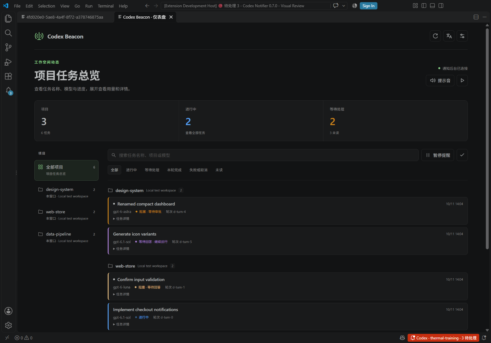

# Codex Beacon · Codex 灯塔

[简体中文](README.md) · [English](README.en.md) · [Downloads](https://github.com/Young581/codex-beacon/releases) · [Marketplace](https://marketplace.visualstudio.com/items?itemName=Young581.codex-beacon)

Track Codex tasks by project in VS Code with colored status lights, token usage, estimated API costs and completion alerts.

为 VS Code 中的 Codex 提供按项目分组的任务列表、状态灯、token 与费用估算，以及完成提醒。[阅读完整中文说明 →](README.md)

Based on the MIT-licensed [lengmo1996/codex-vscode-notifier](https://github.com/lengmo1996/codex-vscode-notifier), with Windows PowerShell path fixes and installation helpers. The current code versions are **Codex Beacon 0.9.0** and **Collector 0.5.9**. Features include sound volume, sounds for different events, conversation grouping, numbered rounds and a dashboard with common management controls. Check the installed extension's details for its Marketplace version; the latest fixes are available from Releases.

## Features

- Alerts when each Codex response ends, with optional system desktop notifications and sound.
- Window title and taskbar indicators to help locate windows needing attention.
- Tasks grouped by project directory and source, with one task per request round; switch to unread/read notification history when needed.
- Sidebar task buttons open the corresponding Codex conversation and mark its reminder read after successful navigation. Project-level buttons switch to or reopen local, SSH or container project windows.
- Colored states for running, waiting for input or approval, response complete, failed, canceled and unknown.
- Per-round token usage by model, estimated API costs in USD and custom model prices.
- Unread reminders tracked independently from task state. Multiple notifications for one task are merged, with deduplication and session navigation preserved.
- Structured question alerts. The approval hook registers automatically after healthy collection starts; review and trust it in Codex.
- A dashboard management page for language, sound, conversation opening location, approval alerts, tests, connection status, history and privacy cleanup.
- Chinese and English interfaces.

A completed response does not mean a deployment, training run or other background job has finished. Local Windows and Ubuntu 24.04 desktop operation have been verified. macOS is a preview requiring physical desktop acceptance. Full SSH/container/WSL integration requires separate verification. See [platform support](docs/platforms.md).

## Installation

Requires **Windows or a Linux desktop (macOS preview), VS Code 1.96+ and Python 3.8+**. Linux/macOS default to `python3`. Linux notifications need `notify-send`; audio needs `pw-play`, `paplay` or `ffplay`.

Install [Codex Beacon](https://marketplace.visualstudio.com/items?itemName=Young581.codex-beacon) from the VS Code Marketplace, published by **Young581**. Local collection is included. For SSH/container projects, install [Codex Beacon Collector](https://marketplace.visualstudio.com/items?itemName=Young581.codex-beacon-collector) in the target environment, or use **Check / install components for this environment** in the main extension to locate it.

Alternatively, download the main extension and collector VSIX files from [Releases](https://github.com/Young581/codex-beacon/releases) and choose **Install from VSIX** in VS Code's Extensions view. You can also build them locally:

```powershell
git clone https://github.com/Young581/codex-beacon.git
cd codex-beacon
python -B build.py --output dist
powershell -ExecutionPolicy Bypass -File .\install.ps1
```

The installation script enables completion popups and sound, sets the detected Python path and backs up user settings before changing them. If automatic detection fails, use `-CodeCommand` to specify Microsoft VS Code's `bin/code.cmd`, or `-PythonPath` to specify the Python executable.

Without the script, enable these VS Code user settings:

```json
{
  "codexBeacon.notificationsEnabled": true,
  "codexBeacon.notifyOnDone": true,
  "codexBeacon.desktopNotifications": true,
  "codexBeacon.desktopOnDone": true,
  "codexBeacon.sound": true,
  "codexBeacon.soundOnDone": true
}
```

Windows detects Python in standard installation directories and PATH, then checks its version and required standard libraries. Actual runtimes are preferred over the `py` launcher; if a candidate cannot start, another candidate is tried. Installing the optional launcher or adding Python to PATH is not required. An explicitly configured Python path is validated and retained.

Python is not bundled or automatically downloaded. If no usable runtime is found, install [Python 3.8 or newer](https://www.python.org/downloads/windows/), or set `codexBeacon.localPythonPath` to a working Python executable's absolute path, then click **Management and settings → Tests and connections → Restart current collector**. Configure settings separately for any VS Code Profile other than your default profile.

When tasks are idle, run **Developer: Reload Window**. After an upgrade, if the shared notification process still uses old code, close all VS Code windows, wait 10 seconds and reopen them. Run **Test desktop notification and sound** to verify alerts.

System Do Not Disturb, notification permissions and mute settings may affect alerts. When taskbar status is first enabled, the extension prepends `${codexBeaconNotification}${separator}` to the existing `window.title` template.

## Dashboard

Click the **Codex status-bar button**, the **dashboard icon** at the top of the task sidebar, or run **Codex Beacon: Open dashboard**. The dashboard opens in the main editor area and reuses its tab on subsequent clicks. Opening it preserves unread reminders.



- Filter by project and conversation in the left navigation. Narrow windows use project and conversation dropdowns.
- View project counts, running tasks, tasks needing attention and unread reminders.
- Filter by running, needs attention, completed, failed/canceled or unread, and search projects, models or conversations.
- Compact task cards use a single column, showing the chat title, model, state, time and round number in about two to three lines. Each card expands independently.
- Open a session, mark read or delete from the card header. Open the project window beside its name. Tokens, estimated API costs, full identifiers and usage details are kept in the expandable details.
- Management and settings uses category navigation on the left and one control per row on the right. Navigation moves above the content in narrow windows.
- Choose or preview sounds, pause notifications, switch language and open settings from the dashboard. State and data update live.

The dashboard and sidebar share task, pricing and notification data. Unknown usage or cost is not displayed as zero; `*` indicates partial statistics, and costs remain API estimates. The screenshot comes from an isolated real VS Code instance using synthetic data. Reload relevant windows when tasks are idle to enable an installed update.

Chat names are matched by session ID from the current environment's Codex title index and read-only state database. Refresh the dashboard after renaming a chat. Rounds in the same chat share its name and display numbered rounds. Numbers are assigned from retained conversation records: filtering does not change them, but deletion or expiry recalculates them. They are not lifetime conversation round counts. Full identifiers remain in task details. A chat without a title displays an unnamed-conversation label; titles are not generated from chat contents.

## Custom sounds

Use **Management and settings → Alerts and display → Notification sound volume** to set 0–100% volume. The default is 100%; 0% mutes sound. System sounds, custom WAV/MP3 files, all alerts and previews share this level without changing system or other application volumes. `codexBeacon.soundVolume` also takes effect immediately.

Open **Management and settings → Alerts and display → Sound scenario**, select Common, Completion, Question or Approval, then choose a local WAV/MP3 file, preview it or restore the default. You can also run **Codex Beacon: Custom notification sound** and select the scenario. Preview plays sound without a desktop popup, including when the global sound switch is off. A preview adds a test record to history.

Event settings are `codexBeacon.soundFileOnDone`, `codexBeacon.soundFileOnQuestion` and `codexBeacon.soundFileOnApproval`. An empty event setting inherits `codexBeacon.soundFile`; an empty common sound uses the system sound. Each event setting is saved independently, so resetting one does not change the others. Notification playback still follows the global sound switch and the completion sound switch.

You can also set `codexBeacon.soundFile` to a local absolute path in user settings. SSH/container projects use the audio on your local computer. Changes need no reload. When first upgrading from an older version, close all VS Code windows when tasks are idle, wait 10 seconds and reopen them to update the shared notification process.

A deleted or undecodable audio file falls back to the system sound and shows a warning once. System players may not support some unusual WAV/MP3 encodings; use PCM WAV or a common MP3 encoding. Merged reminders play once, choosing the highest-priority event with sound enabled: approval, question, then completion. Choosing a file does not enable a disabled global sound switch. Audio files stay local and are not packaged or uploaded.

## Runtime and startup fixes

Version 0.8.10 validates a real Python 3.8+ runtime and the required standard libraries before starting collection, tries other usable candidates automatically, and reuses the validated runtime for collection, tests and hook commands. If no runtime works, it shows installation, configuration and restart steps. Exit code 101 indicates startup failure; it does not by itself establish that Codex Home is misconfigured. Recovery was verified using a real Windows executable returning 101 and isolated installation tests of the final VSIX packages.

Notification and taskbar helper processes use the absolute PowerShell path in the Windows system directory. This fixes `spawn powershell.exe ENOENT` when VS Code inherits a PATH without PowerShell. The fix does not change the system PATH or relax communication authentication.

Regression checks start real helper processes with an empty PATH; two upstream test issues were also corrected. See [verification notes](docs/verification.md) for test scope and provenance.

## Development and verification

Run on Windows with Node 24 and Python 3.13:

```powershell
python -B packaging/sync-local-collector.py --check
$tests = Get-ChildItem tests -Filter '*.js' | Where-Object { $_.Name -ne 'tls-runtime-smoke.js' } | ForEach-Object { $_.FullName }
node --test --experimental-test-isolation=none $tests
python -B tests/remote-collector.py
python -B tests/package-validation.py
python -B test-configuration.py
python -B build.py --output dist
```

Real VS Code extension-host tests use isolated user data and synthetic conversations as described in the [host-test guide](packaging/README.md). CI runs Windows, Linux and macOS checks and creates downloadable build artifacts. macOS desktop acceptance remains pending.

## Project tasks and estimated costs

After VS Code or collection restarts, saved running/waiting states become unknown until a new activity event confirms them. Explicit completed, failed and canceled results remain final. Starting a new round automatically marks earlier-round reminders read within the same project, source and conversation, retaining history and usage while canceling queued old alerts. The current round and other conversations keep their unread reminders.

The **Codex Beacon → Tasks** sidebar groups tasks by project directory and source by default. Identically named projects with different directories or sources remain separate, and the current window's project appears first. Each request round is one task; it does not represent an entire project or background job. Click to open its conversation, or hover to see the full directory, round, model and usage. The grouping button switches to notification history.

Popup and sound tests appear in a separate **Test** group with a test-tube icon and timestamp. Test records do not show task usage or unknown states and do not count toward dashboard project statistics.

The header uses a short Tasks title and icon buttons. Mark all read, clear read, clear all and the full notification menu are available under **“…”**, including in a narrow sidebar.

Menus follow the VS Code interface language by default. Choose `auto`, `zh-CN` or `en` in the notification menu or `codexBeacon.language`. Context menus and header actions use one language and switch immediately with the extension language. The command palette and settings use VS Code's interface language.

The sidebar groups project → conversation name → numbered round. Task rows show the round and a short state. Tokens, cost and full usage are in hover information and expandable dashboard details; `*` means partial statistics.

Hover over a project group and click **Open project window**. This switches to or restores the project window and preserves unread state. Clicking a task or its adjacent button opens the corresponding conversation. Saved project URIs can restore windows even when their notification component is disconnected, including multi-root workspace files and remote connection addresses. A closed child project is not redirected to its parent directory's window.

For older notifications without a remote address, the extension tries VS Code's recent projects. If multiple SSH/container connections match the same path, choose the connection. If connection information is unavailable, open the correct remote project manually once so subsequent notifications can remember it.

| State | Color | Evidence |
| --- | --- | --- |
| Running | Blue | Explicit task start or resume event |
| Blocked · waiting for input | Yellow | Structured question; resumes after a reply |
| Waiting for input · still running | Purple | Asynchronous question while work continues |
| Blocked · waiting for approval | Orange | Configured approval reminder hook |
| Response complete | Green | End of the current response |
| Failed | Red | Explicit task failure event |
| Canceled | Gray | Explicit interruption event |
| Unknown | Gray | Disconnected source window or no state in the log |

State reflects the latest collected event. Silence or a single tool error is not treated as task failure. Older completion notifications without a start event remain complete, but no token usage is invented. Usage updates are silent and do not add unread reminders. Clearing read history retains running tasks and usage for tasks that still have unread reminders.

Default rates come from the [OpenAI pricing table](https://developers.openai.com/api/docs/pricing), checked on **2026-10-10**, in USD per million tokens. Short-context pricing is the default. A recorded `service_tier` selects that tier; otherwise Standard is used. Override context and tier with `codexBeacon.pricingContext` and `codexBeacon.pricingTier`.

Built-in models: `gpt-6.1-sol`, `gpt-6-astra`, `gpt-6-luna`, `gpt-5.6-sol` and `gpt-5.3-codex`. Amounts are **API estimates, not actual bills**, and exclude other conversations, subagents and background jobs. Unknown models or unsupported tiers remain unknown; models without a rate show a missing-price label. Reasoning tokens are included in output. Cache hits and cache writes are deducted from ordinary input to avoid double counting, and model switches are priced separately.

Set `codexBeacon.modelPrices` in VS Code settings to override final rates by exact model name. Custom rates are not multiplied by a service-tier factor. Include `cacheWrite` when cache-write tokens occur:

```json
{
  "codexBeacon.groupBy": "project",
  "codexBeacon.modelPrices": {
    "my-model": {"input": 2, "cachedInput": 0.1, "cacheWrite": 2.5, "output": 10}
  }
}
```

Per-round usage is calculated from increments in cumulative counts, rather than assigning the whole conversation's cumulative usage to one task. A missing complete baseline is labeled partial; absent usage is labeled as unavailable. Only bounded tails of recently active logs are read, rather than scanning all historical chat contents.

The adapter uses Codex log formats observed locally. The [official App Server documentation](https://developers.openai.com/codex/app-server) describes token-usage events, but session logs are not a stable public API. Unrecognized formats retain unknown values.

## Planned work

- Status and notification integrations for more AI coding tools.
- Project budgets, usage filters and statistics export.

These are plans and are not implemented in the current version.

## Attribution and license

Based on upstream commit `4fa74775c65980a5015e0515b5877bc4ebe51e45`, with original copyright notices and the [MIT license](LICENSE) retained. [UPSTREAM.md](UPSTREAM.md) preserves the original project introduction.

This is an independently maintained derivative with two separate Marketplace listings: `Young581.codex-beacon` and `Young581.codex-beacon-collector`. Commands, settings, caches and hook ownership use independent identifiers. See [Marketplace and migration notes](docs/marketplace.md). Old notification history is not imported. Disable the old notifier when tasks are idle before enabling Beacon, and reapply your custom settings.
